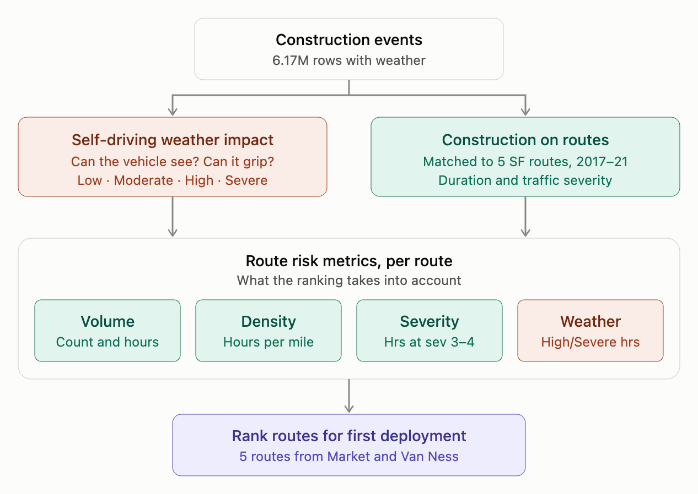
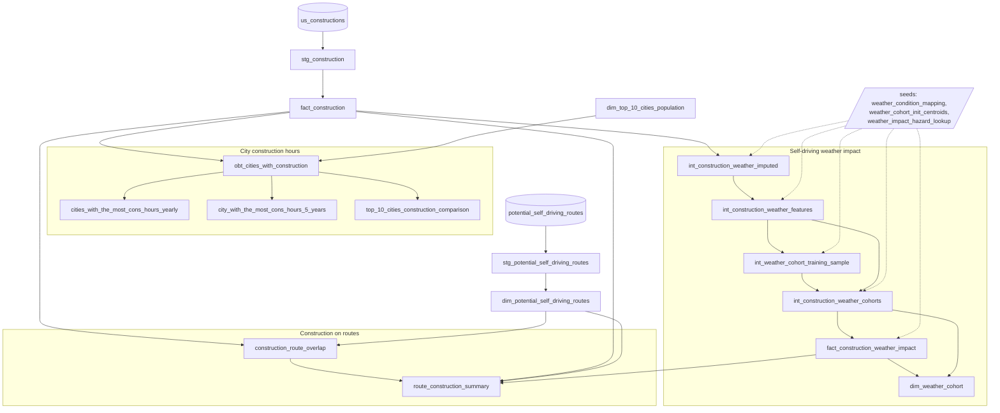

# Road Construction and Autonomy

## At a glance

The project ranks 5 candidate self-driving routes out of San Francisco for a first deployment, using 6.17M US road construction events from 2016–2021. Two separate inputs feed the ranking: a weather score for each event (how hard conditions were for a self-driving vehicle) and the construction that sat on each route. A third, separate analysis compares construction across US cities.

The two branches are kept separate on purpose. The weather score uses weather only, and construction severity, hours and counts are added only at the route step, so no factor is counted twice.

**Detailed methodologies**

| Methodology | Covers |
| --- | --- |
| [Methodology: Construction on Potential Self-Driving Routes](https://claude.ai/artifact/YP5FVXQf63Q1Z4NSh15b46#42ce0d2e-bac2) | Matching constructions to the 5 SF routes, overlap types and the 50 m rule, route metric definitions, map and chart, assumptions and parameters |
| [Weather Impact on Self-Driving: Methodology (Executive Summary)](https://claude.ai/artifact/YCxzDFXCAa6nRRmw9VnGmc#ec00e578-2233) | Plain-language approach to the weather score, results by cohort, how to use the output, limitations |
| [Weather Impact on Self-Driving: Technical Methodology](https://claude.ai/artifact/4P4Y5X1bgxS4tomBDoq5df#59635bb7-97e5) | Cleaning rules, imputation levels, feature mapping, k-means training and choice of k, scoring formula and calibration, tests, runtime and limitations |

## What's in the project

Everything is a dbt project on BigQuery under `road_construction_autonomy/`, plus three notebooks under `notebooks/`. Models flow staging → intermediate → warehouse → analytics.

| Layer | Object | What it holds |
| --- | --- | --- |
| Staging | `stg_construction` | Source construction events, cleaned types |
| Staging | `stg_potential_self_driving_routes` | Source route lines |
| Warehouse | `fact_construction` | One row per construction (6.17M), with location, times, severity and weather |
| Warehouse | `dim_potential_self_driving_routes` | One row per candidate route (5): name, route line, distance |
| Warehouse | `dim_top_10_cities_population` | 10 largest US cities: population (Census, July 2025) and land area |
| Intermediate | `int_construction_weather_imputed` | Weather with impossible values removed and gaps filled |
| Intermediate | `int_construction_weather_features` | Weather type, intensity and hazard flags |
| Intermediate | `int_weather_cohort_training_sample` | Stratified 473,984-row sample for clustering |
| Intermediate | `int_construction_weather_cohorts` | Weather cohort per construction (BigQuery ML k-means, k = 9) |
| Warehouse | `fact_construction_weather_impact` | Self-driving weather score (0–10) and level per construction |
| Warehouse | `dim_weather_cohort` | One row per cohort (10, incl. Unknown) with profile and mean score |
| Analytics | `obt_cities_with_construction` | Construction hours and counts per city per month, 2017–2021 |
| Analytics | `cities_with_the_most_cons_hours_yearly` | City with the most construction hours in each year |
| Analytics | `city_with_the_most_cons_hours_5_years` | City with the most construction hours over 2017–2021 |
| Analytics | `top_10_cities_construction_comparison` | Top 10 cities compared, raw and per population or area |
| Analytics | `construction_route_overlap` | Each construction matched to the routes it touches |
| Analytics | `route_construction_summary` | Route risk metrics, one row per route |
| Seed | `weather_condition_mapping.csv` | 111 weather conditions mapped to type, intensity and flags |
| Seed | `weather_impact_hazard_lookup.csv` | Visibility, precipitation and traction hazard lookups |
| Seed | `weather_cohort_init_centroids.csv` | Starting centroids for the k-means model |
| Notebook | `weather_cohort_exploration.ipynb` | Exploration behind the cohorts and choice of k |
| Notebook | `top_10_cities_trend.ipynb` | Table and charts comparing the top 10 cities |
| Notebook | `self_driving_routes_construction.ipynb` | Route table, chart and map |

Macros (`weather_imputation`, `weather_cohorts`, `weather_impact`), 11 data tests in `tests/` and `analyses/weather_impact_score_breakdown.sql` support the weather models. All tunable thresholds are `vars` in `dbt_project.yml`.

## Lineage

All three analyses start from `fact_construction`.

## City construction hours

These models answer which cities had the most construction, and how the 10 largest US cities compare once city size is accounted for. All use constructions that started from 1 January 2017 up to 1 January 2022.

1. **Build one wide table.** `obt_cities_with_construction` sums construction per city, state and month: hours (end time minus start time), miles, count, and count at high severity (3 or 4). It joins the top 10 cities' population and land area; other cities have these blank.
2. **Rank cities each year.** `cities_with_the_most_cons_hours_yearly` keeps the city with the most hours in each year (ties all kept), with its share of high severity constructions (`high_severity_pct`, a 0–1 ratio) and hours per construction.
3. **Rank cities over 5 years.** `city_with_the_most_cons_hours_5_years` keeps the top city over the whole period, with its yearly average (total ÷ 5).
4. **Compare the top 10 fairly.** `top_10_cities_construction_comparison` shows each top 10 city's raw counts and hours next to normalized figures: per 1,000 residents, per square mile, and mile-hours per square mile (hours × miles, so long and long-lasting closures weigh more).

`top_10_cities_trend.ipynb` turns the comparison into a shaded table and one bar chart per measure, colored green (low) to red (high) on a log scale.

## Self-driving weather impact

Every construction event gets a 0–10 score for how hard the weather was for a self-driving vehicle. 94.9% of events score Low, 3.9% Moderate, 0.75% High and 0.40% Severe.

1. **Clean.** Impossible readings, such as 983 mph wind or 24 inches of rain in an hour, are set to missing and flagged.
2. **Fill gaps.** About 17% of events missed at least one value. Gaps are filled from other events in the same zip code or city at about the same time; no rows are dropped. Weather type is never guessed and becomes Unknown (1.2%) when it can't be filled.
3. **Group into cohorts.** A BigQuery ML k-means model sorts events into 9 weather types (such as Clear/Dry Day, Rain, Fog/Low Visibility, Snow, Freezing/Icy), plus Unknown.
4. **Score.** Each event is scored on two hazards: can the vehicle **see** (fog, heavy rain or snow), and can it **grip** (ice, snow, standing water). The worse hazard sets the score, plus a quarter of the other, plus additions for darkness and strong wind.

| Level | Score |
| --- | --- |
| Low | 0–2.9 |
| Moderate | 3–5.9 |
| High | 6–7.9 |
| Severe | 8–10 |

The rules were calibrated on 11 reference scenarios, for example dense fog at 8 and freezing rain at 9; all land within half a point. Freezing/Icy, Snow and Fog are 2.4% of events but hold most High and Severe scores. The score is an expert estimate: no self-driving outcome data was available to validate it.

**Details:** [Executive Summary](https://claude.ai/artifact/YCxzDFXCAa6nRRmw9VnGmc#ec00e578-2233) (plain-language summary and results by cohort) and [Technical Methodology](https://claude.ai/artifact/4P4Y5X1bgxS4tomBDoq5df#59635bb7-97e5) (cleaning rules, imputation levels, feature mapping, choice of k, scoring formula, tests and limitations).

## Construction on routes

A construction counts on a route when it lies fully on the route, or when at least 50 m of it overlaps the route. The 5 routes all start at Market & Van Ness and go to San Rafael, San Leandro, San Mateo, Berkley and Pacifica; constructions that started in 2017–2021 are counted.

1. **Draw each construction's area.** A straight line from start to end, widened 10 m each side (about one lane). If start and end are within 1 m, or the end is missing (about 10% of rows), the area is a 10 m circle.
2. **Find the routes it touches.** One construction can count on several routes, for example on the Bay Bridge stretch shared by the Berkley and San Leandro routes.
3. **Classify the overlap.** `full` = start and end both within 10 m of the route; `partial` = more than 20 m of route inside the area; `crossing` = 20 m or less (the route cuts across); `none` = no route touched.
4. **Drop weak matches.** Keep `full`, or any match with at least 50 m of overlap. This removes long constructions on other roads that clip the route, and side-street closures that only meet it.

Each counted construction adds its full duration to the route, not a share prorated by overlap length. The route ranking stayed the same under all three matching rules tried. `self_driving_routes_construction.ipynb` draws the route table, a bar chart and a map of each route with its construction spots.

**Details:** [Methodology: Construction on Potential Self-Driving Routes](https://claude.ai/artifact/YP5FVXQf63Q1Z4NSh15b46#42ce0d2e-bac2) (overlap rules, metric definitions, map and chart, assumptions and parameters).

## Route risk metrics

`route_construction_summary` holds one row per route with the four kinds of metric the ranking takes into account. A route with less of each is a better first deployment.

| Metric group | Column | Definition |
| --- | --- | --- |
| Volume | `construction_count` | Number of matched constructions |
| Volume | `construction_hours` | Sum of each construction's duration, in hours |
| Density | `construction_hours_per_mi` | Construction hours ÷ route distance in miles |
| Severity | `high_severity_hours` | Construction hours at traffic severity 3 or 4 |
| Weather | `high_severe_impact_hours` | Construction hours where the weather impact level is High or Severe |

The table also carries the route line (`path_geography`) and where each construction meets the route (`construction_spots`), for maps. The notebook currently orders routes by construction hours. Weather hours are small (10 to 846 per route), so differences between routes on that metric rest on few events.

Open question: how to weight the four metric groups into one final ranking.

## How to run

The whole project rebuilds with dbt, then the notebooks read the built tables.

1. Set up the dbt profile `road_construction_autonomy` in `~/.dbt/profiles.yml` (BigQuery, OAuth via `gcloud auth application-default login`).
2. From `road_construction_autonomy/`, load seeds, build every model and run the tests: `dbt build`. To rebuild one area only, select it, for example `dbt build -s construction_route_overlap route_construction_summary`.
3. To retrain the weather cohort model, run with `--vars '{refit_cohort_model: true}'`; otherwise the existing model is reused.
4. For the notebooks, copy `notebooks/.env.example` to `notebooks/.env` and fill in the project and datasets (unset values fall back to the dbt profile), then install `notebooks/requirements.txt` and run the notebook.

Analytics tables land in the `obt_road_construction_and_antonomy` schema; warehouse tables in `dwh_road_construction`.
